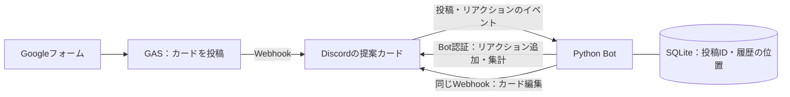

# camp-seminar-bot

GoogleフォームからDiscordへ合宿ゼミの班提案を投稿し、参加希望のリアクションを集計するBotです。

提案者はフォームに回答するだけで募集できます。参加者はDiscordのカードに付いた **1️⃣ 第一志望・2️⃣ 第二志望・3️⃣ 第三志望** を押して希望を伝えられます。

## できること

- フォーム最初の質問「名称」の回答をカードの見出しにする（本文で重複表示しない）。
- 提案カードに投票用リアクションを自動で付ける。
- 志望別の人数を表示し、追加・取り消しを反映する。
- 第一志望が3人以上になるとピンクから緑へ変更。3人未満に戻るとピンクへ戻す。
- 再起動後や通信復旧後も、既存カードの状態を再確認する。

成立目安に達したときは、人数と色で示します。カード末尾に「成立」は表示しません。

## 構成



GASはGoogle側で動き、Python BotはパソコンまたはDockerを使うサーバーで動きます。Webhookはカードの投稿・編集、BotトークンはDiscordへの接続・リアクション操作に使います。

## はじめ方

初めて導入する方は、次の順に進めてください。

1. **[セットアップ](docs/setup.md)** — Discord Bot・Webhook・Googleフォームを準備する。
2. **手元で試す** — 下記のコマンドでBotを起動する。
3. **[Dockerで運用する](docs/operations.md)** — サーバーで常時稼働させる。

```sh
git clone https://github.com/wathematica/camp-seminar-bot.git
cd camp-seminar-bot
python3 -m venv .venv
```

macOS / Linux：

```sh
.venv/bin/python -m pip install -r requirements.txt
.venv/bin/python run_local.py
```

Windows PowerShell：

```powershell
.\.venv\Scripts\python.exe -m pip install -r requirements.txt
.\.venv\Scripts\python.exe run_local.py
```

Python 3.12を推奨します。画面の案内に従いBotトークン・Webhook URLを入力します。入力は非表示で、手元の試用では秘密情報を保存しません。停止は `Ctrl+C`。試用中はパソコンとターミナルを起動したままにしてください。

## 集計ルール

| 操作 | 結果 |
|---|---|
| 1️⃣を押す | 第一志望として1人加算 |
| 同じカードに1️⃣と2️⃣を押す | 第一志望だけに加算 |
| 1️⃣を外し、2️⃣だけ残す | 第一志望から減算し、第二志望に加算 |
| Botがリアクションを付ける | 人数には含めない |

通常リアクションとスーパーリアクションの両方を押しても、同じ人は1人です。リアクション横の数字にはBotの分も入るので、カード内の人数と異なる場合があります。

班をまたいだ希望順位の重複は制限しません。Googleフォームの回答編集を既存カードへ反映する機能もありません。

## ファイル案内

```text
camp-seminar-bot/
├── README.md             # 最初に読む案内
├── bot.py                # Discordイベント・カード更新・再確認
├── voting.py             # 集計ルールと表示
├── storage.py            # SQLiteへの記録
├── run_local.py          # 非表示入力による手元での試用
├── configure.py          # サーバー用の秘密情報を保存
├── gas/onSubmit.gs       # Googleフォーム側に貼る投稿専用GAS
├── compose.yaml          # Docker起動・永続化・再起動設定
├── Dockerfile            # Python実行環境の作成
├── .env.example          # 人数などの設定例（秘密情報なし）
├── docs/                 # セットアップ・運用・内部構成
└── tests/                # ネットワーク不要のテスト
```

旧GASの集計版、個人の検証ログ、トークン、データベースはこのリポジトリに含めません。

## 開発・検証

```sh
.venv/bin/python -m unittest discover -s tests -v
# GASのテスト（Node.js 22以上）
node --test tests/test_gas.cjs
docker compose config --quiet
```

内部の動きは **[設計メモ](docs/architecture.md)** を参照してください。テストはDiscordに接続せず、投票優先順位・表示・保存・イベント判定などを検証します。

手元の実Discord環境では、自動リアクション・人数更新・取り消し・色変更を確認済みです。Dockerコンテナのビルドと自宅サーバー上の稼働はまだ未検証です。
